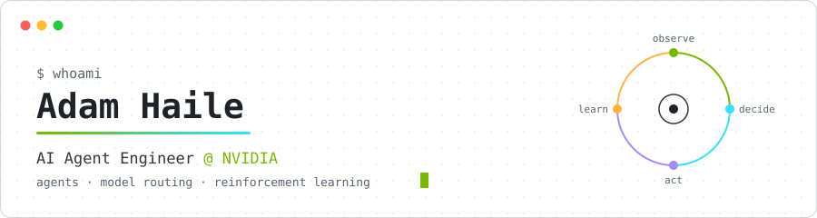
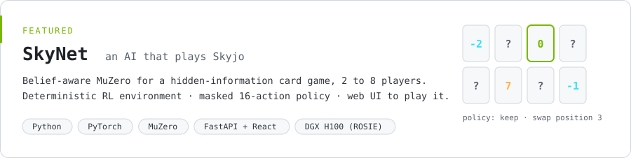
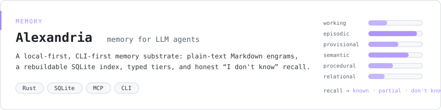
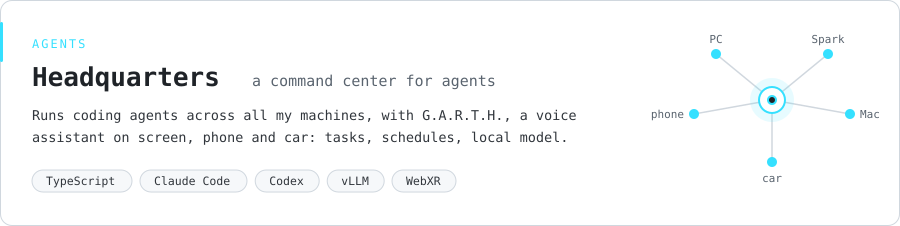

<picture>
  <source media="(prefers-color-scheme: dark)" srcset="assets/header-dark.svg">
  
</picture>

I build agents and the systems around them: how they choose a model, how they act, and how they learn.

### Now

- **AI Agent Engineer at NVIDIA**, contributing to [**Switchyard**](https://github.com/DevArtech/Switchyard): routing LLM traffic across models and providers while keeping native OpenAI and Anthropic APIs.
- **[NVIDIA/switchyard-local-first-routing](https://github.com/NVIDIA/switchyard-local-first-routing)**: local-first routing for Switchyard in Hermes.
- **MSOE**: B.S. in Computer Science (2026); M.S. in Machine Learning, finishing December 2026.

### Featured

<a href="https://github.com/DevArtech/skynet">
  <picture>
    <source media="(prefers-color-scheme: dark)" srcset="assets/skynet-dark.svg">
    
  </picture>
</a>

<a href="https://github.com/DevArtech/alexandria">
  <picture>
    <source media="(prefers-color-scheme: dark)" srcset="assets/alexandria-dark.svg">
    
  </picture>
</a>

<a href="https://github.com/DevArtech/headquarters">
  <picture>
    <source media="(prefers-color-scheme: dark)" srcset="assets/headquarters-dark.svg">
    
  </picture>
</a>

### Stack

`Python` `TypeScript` `Rust` · `PyTorch` · `RL` `LLM agents` `RAG` · `FastAPI` `React` `Next.js` · `Docker` `SLURM`

[devartech.net](https://devartech.net) · [LinkedIn](https://www.linkedin.com/in/devartech/) · [Instagram](https://www.instagram.com/devartech/) · [X](https://twitter.com/DevArtech)
